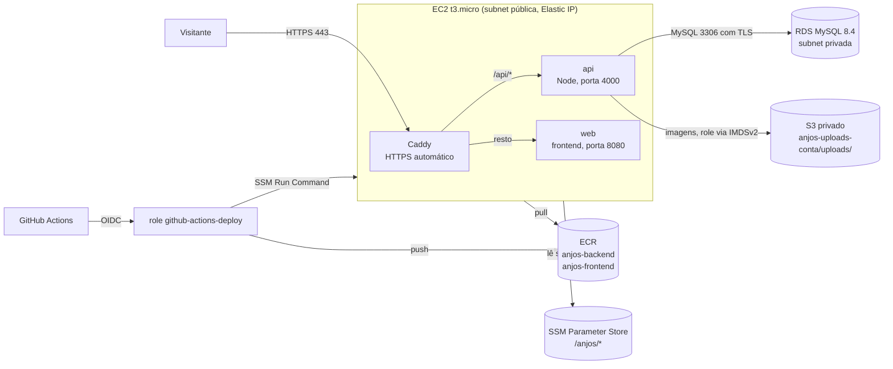
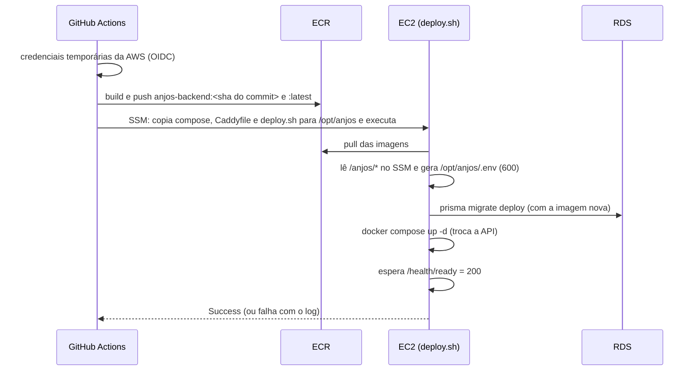

# Deploy na AWS

Como o sistema Anjos Protetores é publicado em **https://abrigoanjosprotetores.com.br**.
A infraestrutura (rede, EC2, banco, ECR, permissões) é criada pelo Terraform em `infra/`
(ver `infra/README.md`). Este documento explica o que acontece **depois**: como uma versão
nova chega ao servidor.

> Nenhum segredo fica no repositório. Senhas e chaves ficam no SSM Parameter Store
> (criptografadas) e só são lidas pela EC2 na hora do deploy.

## Arquitetura



Em texto:

```
Internet ──443──► Caddy ──/api/*──► api (Node) ──TLS──► RDS MySQL (privado)
                    └────resto────► web (frontend)
GitHub Actions ──OIDC──► AWS: push da imagem no ECR + comando de deploy na EC2 (SSM)
```

| Peça | O que faz |
|---|---|
| **Caddy** (`deploy/Caddyfile`) | Único container exposto à internet. Emite e renova sozinho o certificado HTTPS (Let's Encrypt), redireciona HTTP→HTTPS e `www`→domínio sem `www` (301), comprime as respostas e manda `/api/*` para a API e o resto para o frontend |
| **web** | Frontend (imagem `anjos-frontend` do ECR), porta interna 8080 |
| **api** | Backend (imagem `anjos-backend` do ECR), porta interna 4000, usuário não-root `node` |
| **RDS** | Banco MySQL gerenciado, sem IP público, só aceita conexões com TLS |
| **S3** | Bucket privado com as fotos de animais e eventos; a API grava só em `uploads/` |

Frontend e API ficam no **mesmo domínio** (`/` e `/api`), então o navegador não faz
requisições entre origens diferentes (não depende de CORS). O frontend deve ser compilado
chamando a API por caminho relativo (`VITE_API_URL=/api`).

### Por que estas escolhas

- **Uma EC2 com Docker Compose** em vez de ECS/Kubernetes: é o mais simples e barato que
  atende um sistema deste porte, e é fácil de explicar e operar.
- **Caddy** em vez de Nginx + Certbot: o HTTPS é automático (pede e renova o certificado
  sem configuração extra).
- **Deploy por SSM** em vez de SSH: nenhuma porta 22 aberta e nenhuma chave SSH para vazar.
  Cada comando fica registrado na AWS (CloudTrail).
- **OIDC** em vez de chave de acesso no GitHub: as credenciais duram 1 hora e só a branch
  `main` consegue usá-las.

## Fluxo do deploy

Todo push na `main` (ou um disparo manual em *Actions > Deploy > Run workflow*) executa
`.github/workflows/deploy.yml`:



1. **Credenciais**: `configure-aws-credentials` assume a role `github-actions-deploy` com o
   ARN da variável do repositório `AWS_ROLE_ARN`.
2. **Imagem**: build do `Dockerfile` e push com duas tags: o SHA do commit (única; é a que
   vai para o servidor e mostra exatamente o que está no ar) e `latest`.
3. **Encontrar a EC2** pela tag `Name=anjos-app` (o ID não fica fixo no workflow).
4. **SSM Run Command**: os três arquivos de `deploy/` vão em base64 para `/opt/anjos` e o
   `deploy.sh` roda com `BACKEND_IMAGE=<sha>` e `FRONTEND_IMAGE=anjos-frontend:latest`.
5. **`deploy.sh`** (na EC2):
   1. login no ECR e `docker pull` das imagens;
   2. lê `/anjos/database_url`, `/anjos/jwt_secret` e `/anjos/db_password` do SSM e gera
      `/opt/anjos/.env` com permissão `600` (inclui `NODE_ENV=production`,
      `CORS_ORIGIN=https://abrigoanjosprotetores.com.br`, `TRUST_PROXY=1` e, se existirem
      os parâmetros `/anjos/abrigo_cidade` e `/anjos/abrigo_telefone`, os dados do termo em PDF);
   3. roda `prisma migrate deploy` num container temporário **com a imagem nova, antes de
      trocar a API**. Se falhar, para aqui e a versão antiga continua no ar;
   4. `docker compose up -d` (só recria o que mudou) e recarrega o Caddy;
   5. espera `GET /health/ready` responder 200 (API conectada ao banco). Se não ficar pronta
      em ~2 minutos, mostra o log da API e falha;
   6. apaga imagens antigas sem uso.
6. O job espera o comando terminar e **falha se o status não for `Success`**, mostrando a
   saída do `deploy.sh`.

Dois deploys nunca rodam ao mesmo tempo (`concurrency` no workflow e um `flock` no
`deploy.sh`). Rodar o deploy de novo com a mesma versão não muda nada (idempotente).

### Configuração necessária no GitHub (uma vez)

Em *Settings > Secrets and variables > Actions > Variables*, crie a variável
`AWS_ROLE_ARN` com o valor do output `github_actions_role_arn` do Terraform. Não é segredo
(é só um identificador), mas fica fora do código para não fixar a conta no workflow.

### Como a AWS reconhece o GitHub (claim `sub`)

A cada execução, o GitHub entrega ao workflow um token com um campo `sub`, que diz de onde a
execução veio. A trust policy da role (`infra/github_oidc.tf`) compara esse campo com uma
lista fechada: **só a branch `main` dos dois repositórios** é aceita.

O GitHub passou a enviar o `sub` com **IDs imutáveis** do dono e do repositório, porque um
nome pode mudar ou ser reaproveitado, mas o ID não. A role aceita os dois formatos:

```
repo:fifieggert@168691455/anjos_protetores---backend@1362769302:ref:refs/heads/main    # novo
repo:fifieggert/anjos_protetores---backend:ref:refs/heads/main                         # antigo
```

O frontend segue o mesmo modelo, com o ID `1362871407`. Os IDs estão em
`infra/variables.tf` e não são segredos. Há duas formas de descobri-los:

- Pela API do GitHub:

  ```bash
  gh api repos/fifieggert/anjos_protetores---backend --jq .id        # ID do repositório
  gh api repos/fifieggert/anjos_protetores---backend --jq .owner.id  # ID do dono
  ```

- Pelo CloudTrail: o erro do job (`Not authorized to perform
  sts:AssumeRoleWithWebIdentity`) não mostra o `sub`, mas o evento
  `AssumeRoleWithWebIdentity` registra o valor que o GitHub enviou.

### Conexão com o banco (TLS)

A `DATABASE_URL` do SSM tem o formato:

```
mysql://anjos:<senha>@<endpoint-rds>:3306/anjos_protetores?ssl=true&sslaccept=strict&sslcert=/certs/rds-ca.pem
```

- A **API** (`src/utils/conexaoBanco.ts`) lê o arquivo de `sslcert` e só confia nesse
  certificado da AWS, validando a cadeia e o nome do servidor. Também define prazos curtos
  de conexão (3 s), para a API não ficar presa quando o banco cai.
- O **`prisma migrate deploy`** entende `sslaccept=strict` e `sslcert` (e ignora `ssl=true`).
- O arquivo `/certs/rds-ca.pem` é o pacote de certificados do RDS, baixado pelo `user_data`
  da EC2 em `/opt/anjos/certs` e montado no container em `/certs` (somente leitura).

## Upload de imagens (S3)

As fotos de animais e de eventos ficam no bucket S3 **privado** `anjos-uploads-<id-da-conta>`,
criado em `infra/armazenamento.tf` (detalhes, validação e limpeza em `infra/README.md`,
seção *Upload de imagens (S3)*).

- **Acesso**: só a role da EC2, e só no prefixo `uploads/` (`PutObject`, `GetObject`,
  `DeleteObject` e `ListBucket` com prefixo `uploads/`). Block Public Access ligado, sem ACLs,
  criptografia SSE-S3, HTTPS obrigatório e sem versionamento.
- **Credenciais**: o container da API usa o SDK da AWS com a role da instância, pelo IMDSv2
  (hop limit 2). **Nenhuma chave de acesso vai para o `.env`.**
- **Configuração**: o Terraform grava o nome do bucket em `/anjos/s3_bucket` (String, não
  secreto). A API precisa de `S3_BUCKET` e `AWS_REGION`.

### Mudança proposta no `deploy.sh` (ainda não aplicada)

A menor mudança é o `deploy.sh` ler o parâmetro junto com os outros e gravar as duas
variáveis no `.env`. A região já existe no script (`REGIAO`). O parâmetro é lido como opcional
para o deploy não quebrar antes do `terraform apply`:

```diff
 ABRIGO_TELEFONE="$(ler_opcional /anjos/abrigo_telefone)"
+S3_BUCKET="$(ler_opcional /anjos/s3_bucket)"
@@
-for nome in DATABASE_URL JWT_SECRET ABRIGO_CIDADE ABRIGO_TELEFONE; do
+for nome in DATABASE_URL JWT_SECRET ABRIGO_CIDADE ABRIGO_TELEFONE S3_BUCKET; do
@@
 ABRIGO_TELEFONE='$ABRIGO_TELEFONE'
+
+# Upload de imagens (S3). As credenciais vêm da role da EC2 (IMDSv2), não daqui.
+AWS_REGION='$REGIAO'
+S3_BUCKET='$S3_BUCKET'
 EOF
```

O `docker-compose.prod.yml` não precisa mudar: o serviço `api` já carrega o `/opt/anjos/.env`
(`env_file`). Ordem segura: `terraform apply` → merge do `deploy.sh` → deploy da versão da API
que usa o S3.

## Primeiro usuário ADMIN em produção

Feito uma vez, à mão, **sem a senha passar pelo repositório, pelo GitHub ou pelo histórico
do terminal**. Precisa da AWS CLI e do
[Session Manager plugin](https://docs.aws.amazon.com/systems-manager/latest/userguide/session-manager-working-with-install-plugin.html)
na sua máquina.

```bash
# 1. Na sua máquina: abre um terminal na EC2 (sem SSH). O ID está no output do Terraform
#    "comando_ssm_sessao", ou:
aws ec2 describe-instances --region sa-east-1 \
  --filters Name=tag:Name,Values=anjos-app Name=instance-state-name,Values=running \
  --query 'Reservations[].Instances[].InstanceId' --output text
aws ssm start-session --target <instance-id> --region sa-east-1

# 2. Na EC2:
sudo -i
cd /opt/anjos

# a senha é digitada sem aparecer na tela e não vai para o histórico
read -rsp "Senha do ADMIN: " ADMIN_SENHA; echo
export ADMIN_SENHA

# "-e ADMIN_SENHA" sem valor repassa a variável do shell para o container
docker compose -f docker-compose.prod.yml run --rm --no-deps \
  -e ADMIN_NOME="Coordenação do Abrigo" \
  -e ADMIN_CPF=<cpf-somente-numeros> \
  -e ADMIN_EMAIL=<email-do-admin> \
  -e ADMIN_SENHA \
  api npm run criar-admin:prod

unset ADMIN_SENHA
exit
```

O script valida a senha com as mesmas regras do cadastro, recusa e-mail repetido e imprime
o usuário criado (sem a senha). Depois disso, os outros usuários são cadastrados pelo
próprio sistema.

## Ver logs e estado

Sempre numa sessão do SSM, como root (`sudo -i`), na pasta `/opt/anjos`:

```bash
alias dc='docker compose -f /opt/anjos/docker-compose.prod.yml'

dc ps                       # containers, imagem em uso e saúde
dc logs -f api              # log da API ao vivo (Ctrl+C para sair)
dc logs --since 1h caddy    # acessos e certificados HTTPS (JSON)
dc logs --tail 200 web
grep IMAGE /opt/anjos/.env  # versões em execução (sem mostrar segredos)
```

- Cada container guarda no máximo 30 MB de log (3 arquivos de 10 MB), para não encher o disco.
- O histórico de deploys fica em *Actions > Deploy* no GitHub e em
  *Systems Manager > Run Command > Command history* no console da AWS.
- Não use `cat /opt/anjos/.env`: ele contém os segredos.

## Rollback (voltar para a versão anterior)

As 10 imagens mais recentes de cada repositório ficam no ECR, cada uma com a tag do commit.

**Opção 1 — pelo GitHub (recomendada):** reverta o commit problemático na `main`
(`git revert`) e faça push. O deploy roda sozinho com o código anterior.

**Opção 2 — direto na EC2 (mais rápida, sem build):**

```bash
# na sua máquina: tags disponíveis, da mais nova para a mais antiga
aws ecr describe-images --repository-name anjos-backend --region sa-east-1 \
  --query 'reverse(sort_by(imageDetails,&imagePushedAt))[].[imagePushedAt,imageTags[0]]' --output table

# na EC2 (sessão do SSM, sudo -i):
BACKEND_IMAGE=188289742729.dkr.ecr.sa-east-1.amazonaws.com/anjos-backend:<sha-anterior> \
FRONTEND_IMAGE=188289742729.dkr.ecr.sa-east-1.amazonaws.com/anjos-frontend:latest \
/opt/anjos/deploy.sh
```

O próximo push na `main` volta a publicar a versão nova.

**Atenção às migrations:** o rollback troca só o código; o banco **não** volta atrás. Por
isso as migrations devem ser compatíveis com a versão anterior (adicionar colunas/tabelas
em vez de renomear ou apagar no mesmo deploy). Se uma migration destrutiva der problema,
a saída é restaurar o backup automático do RDS (*RDS > Automated backups > Restore to
point in time*), que cria uma instância nova.

## Custos (sa-east-1, preço sob demanda)

| Item | US$/mês (aprox.) |
|---|---|
| EC2 t3.micro | ~12 |
| RDS db.t4g.micro (MySQL, Single-AZ) + 20 GB gp3 | ~26,5 |
| Disco da EC2 (20 GB gp3) | ~3 |
| Elastic IP (IPv4 público) | ~3,6 |
| ECR (até 10 imagens por repositório, ~1 GB) | ~0,1 |
| S3 uploads (até ~5 GB de fotos + requisições) | ~0,2 |
| SSM (Parameter Store padrão, Run Command, Session Manager), OIDC, IAM | grátis |
| Certificado HTTPS (Let's Encrypt via Caddy) | grátis |
| GitHub Actions | grátis em repositório público; em privado, dentro da cota gratuita mensal |
| **Total** | **~US$ 45/mês (~US$ 1,50/dia)** |

O detalhamento e as premissas estão em `infra/README.md`. Fora do TCC, desligue tudo com
`terraform destroy` para não gerar custo.

## Problemas comuns

| Sintoma | Causa provável |
|---|---|
| Job falha em "Credenciais da AWS" | Variável `AWS_ROLE_ARN` ausente, execução fora da `main` (a role só confia na `main`) ou `sub` diferente do esperado (veja *Como a AWS reconhece o GitHub*) |
| "Esperava 1 EC2 ligada" | EC2 desligada, tag `Name` diferente de `anjos-app`, ou a role sem `ec2:DescribeInstances` (aplicar `infra/github_oidc.tf`) |
| Status `Undeliverable`/`TimedOut` | Agente do SSM fora do ar na EC2; veja *Fleet Manager* no console |
| Migrations falham | `DATABASE_URL` errada, certificado ausente em `/opt/anjos/certs` ou migration inválida. A versão antiga continua no ar |
| API não fica pronta | `dc logs api`. "Não foi possível ler o certificado" = falta `/opt/anjos/certs/rds-ca.pem` |
| Upload falha: `Could not load credentials` ou timeout no IMDS | `HttpPutResponseHopLimit` da EC2 diferente de 2 (ver `infra/README.md`) |
| Upload falha: `AccessDenied` | Chave do objeto fora de `uploads/`, ou `S3_BUCKET` vazio no `.env` (falta `/anjos/s3_bucket` ou o `terraform apply`) |
| Site sem HTTPS | DNS ainda não aponta para o Elastic IP; veja `dc logs caddy` (erros do Let's Encrypt) |
